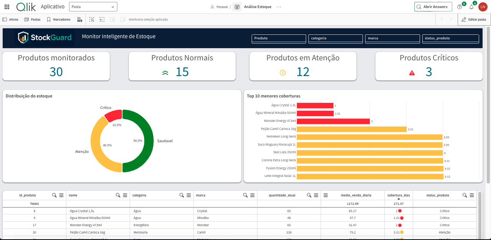
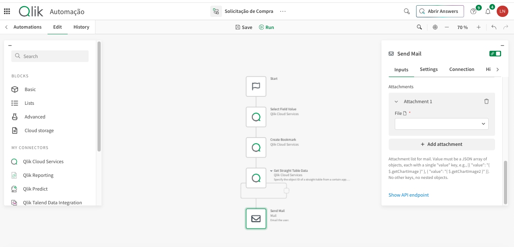
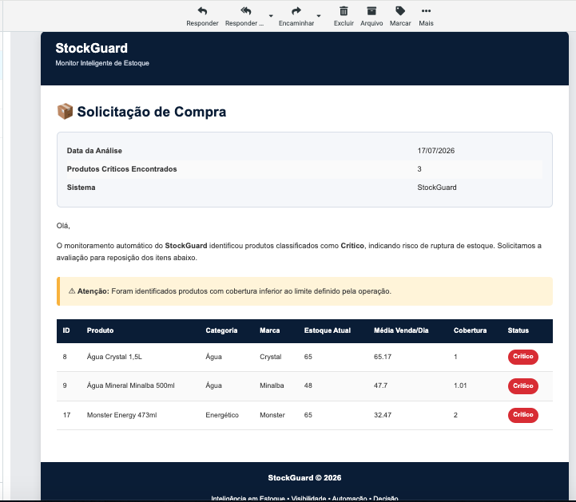
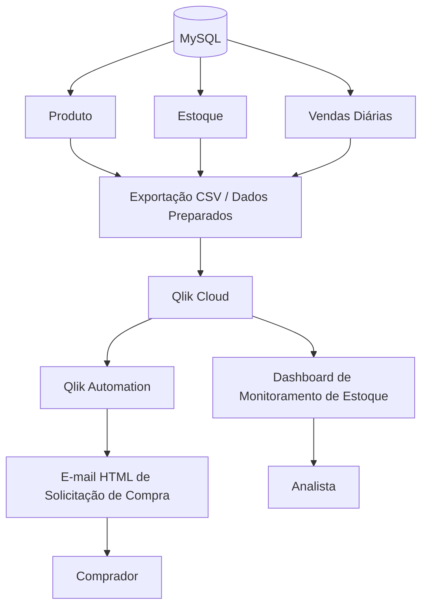

# StockGuard — Monitoramento Inteligente de Estoque


> Projeto de portfólio desenvolvido com dados fictícios para demonstrar como dados operacionais de estoque podem ser transformados em monitoramento, priorização e ações automatizadas.

## Visão geral

O **StockGuard** é uma solução de monitoramento de estoque desenvolvida no **Qlik Cloud**. O projeto vai além da exibição dos níveis atuais de estoque: estima a cobertura em dias, classifica cada produto por nível de risco e conecta situações críticas a um fluxo automatizado de solicitação de compra.

A ideia central é simples:

```text
Dados de Vendas + Estoque
        |
        v
Cálculo de Cobertura de Estoque
        |
        v
Classificação de Risco
        |
        v
Dashboard Qlik
        |
        +--> Atenção -> Acompanhamento do analista
        |
        +--> Crítico -> Qlik Automation -> E-mail de Solicitação de Compra
```

## Problema de negócio

Observar apenas a quantidade disponível pode levar a conclusões equivocadas. Um produto com 300 unidades em estoque pode parecer seguro, mas, se vende 100 unidades por dia, possui apenas três dias de cobertura.

Por isso, o StockGuard utiliza a relação entre o estoque atual e a média diária de vendas para identificar antecipadamente o risco de reposição.

## Principal regra de negócio

A métrica principal é:

```text
Cobertura de Estoque (dias) = Estoque Atual / Média Diária de Vendas
```

Os limites utilizados na demonstração são:

| Status | Regra de cobertura | Significado | Ação |
|---|---:|---|---|
| 🟢 Saudável | > 7 dias | Nível confortável de estoque | Monitoramento normal |
| 🟡 Atenção | > 3 e <= 7 dias | Risco preventivo | Acompanhamento do analista |
| 🔴 Crítico | <= 3 dias | Alto risco de ruptura | Solicitação automatizada de compra |

Os limites são regras de demonstração e podem ser parametrizados de acordo com uma política operacional real.

## Dashboard

O dashboard operacional foi pensado para facilitar a priorização.

### Principais indicadores

- Produtos monitorados
- Produtos em situação saudável
- Produtos que exigem atenção
- Produtos em situação crítica

### Principais análises

- Distribuição dos produtos por status de estoque
- Ranking dos produtos com menor cobertura
- Fila de prioridades com produto, categoria, marca, estoque atual, média diária de vendas, dias de cobertura e status



## Da análise à ação

O diferencial do projeto é que o processo não termina no dashboard.

Produtos classificados como **Atenção** permanecem visíveis para acompanhamento do analista. Produtos classificados como **Crítico** podem acionar um fluxo do Qlik Automation, que recupera os dados relevantes da tabela e envia ao comprador um e-mail consolidado de solicitação de compra.



### Solicitação de compra automatizada

O e-mail reúne os produtos críticos em uma única comunicação e inclui informações como:

- ID do produto
- Nome do produto
- Categoria
- Marca
- Estoque atual
- Média diária de vendas
- Cobertura em dias
- Status



O modelo HTML utilizado nessa mensagem está documentado em [automation/purchase-request-email.html](automation/purchase-request-email.html).

## Arquitetura de dados

A primeira versão utiliza um banco de dados **MySQL** local para geração, armazenamento e validação dos dados de demonstração.



Como a instância MySQL é local, esta versão do portfólio não afirma possuir uma conexão direta e ativa entre MySQL e Qlik Cloud. O fluxo atual do portfólio pode utilizar arquivos exportados para a ingestão no Qlik Cloud. Uma possível evolução é o **Qlik Data Gateway — Direct Access**.

Consulte [Arquitetura](architecture/README.md).

## Modelo relacional

O banco de demonstração contém três tabelas principais:

- `produto` — cadastro de produtos
- `venda_diaria` — histórico diário de vendas
- `estoque` — posição atual do estoque

A regra de cobertura de estoque foi validada no MySQL antes de ser implementada na camada analítica.

Consulte [Validação SQL](sql/README.md).

## Automação

O fluxo de automação representa a camada de ação do projeto:

```text
Produto crítico identificado
        |
        v
Qlik Automation
        |
        v
Recuperar informações do produto
        |
        v
Montar mensagem HTML
        |
        v
Enviar e-mail
        |
        v
Comprador
```

Consulte [Automação](automation/README.md).

## Tecnologias

| Camada | Tecnologia |
|---|---|
| Geração / exportação de dados de demonstração | Python |
| Armazenamento relacional e validação | MySQL |
| Analytics | Qlik Cloud / Qlik Sense |
| Lógica de negócio | Expressões e métricas Qlik |
| Automação | Qlik Automation |
| Layout das notificações | HTML / CSS |

## Conjunto de dados de demonstração

O conjunto de dados do portfólio é fictício e foi criado especificamente para o projeto. Ele inclui:

- 30 produtos
- 30 dias de histórico de vendas por produto
- Estoque atual por produto
- Estoque mínimo por produto

## Por que este projeto é relevante

O StockGuard foi desenvolvido para demonstrar que Business Intelligence não precisa terminar na visualização.

```text
Dados
  |
  v
Informação
  |
  v
Insight
  |
  v
Alerta
  |
  v
Ação
```

O projeto combina **modelagem de dados, validação SQL, analytics Qlik, regras de negócio, priorização operacional e automação** em um pequeno caso de uso de ponta a ponta.

## Melhorias futuras

Possíveis próximos passos incluem:

- Conectividade direta com Qlik Data Gateway
- Limites parametrizados de cobertura
- Atribuição de compradores por categoria de produto
- Histórico de alertas
- Acompanhamento de pedidos de compra
- Previsão de demanda
- Análise do prazo de entrega dos fornecedores
- Sugestão automatizada de quantidade para reposição
- Monitoramento de prevenção de ruptura
- KPIs de eficiência da automação

## Estrutura do repositório

```text
.
├── README.md
├── architecture/
│   └── README.md
├── automation/
│   ├── README.md
│   └── purchase-request-email.html
├── sql/
│   └── README.md
└── screenshots/
    ├── README.md
    └── screenshots/
        ├── 01-stockguard-dashboard.png
        ├── 02-purchase-request-email.png
        └── 03-qlik-automation-flow.png
```

---

**Projeto de portfólio de Luiz Felipe Nunes — Desenvolvedor de BI | Qlik | SQL | Análise de Dados**
