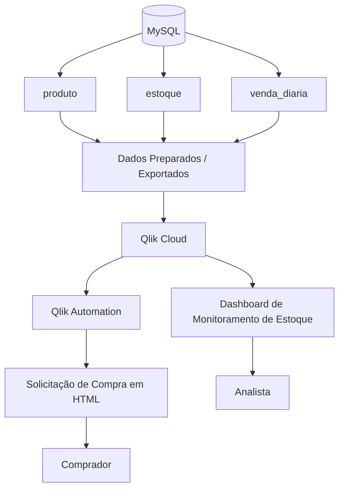

# Arquitetura

## Visão geral

O StockGuard combina uma pequena camada relacional de dados, analytics no Qlik Cloud e uma camada de automação para execução de ações operacionais.

A primeira versão do portfólio utiliza um banco de dados MySQL local para geração, armazenamento e validação dos dados de demonstração.

## Fluxo atual do portfólio



## Camada de dados

O banco contém três tabelas principais:

- `produto` — cadastro de produtos e atributos descritivos;
- `estoque` — posição atual do estoque e estoque mínimo;
- `venda_diaria` — histórico diário de vendas utilizado para calcular o consumo médio.

## Camada analítica

O Qlik Cloud utiliza os dados preparados para calcular e apresentar:

- estoque atual;
- média diária de vendas;
- cobertura de estoque em dias;
- classificação de risco;
- distribuição por status;
- ranking de menor cobertura;
- fila de prioridades operacionais.

## Camada de ação

O projeto separa dois tipos de resposta operacional:

- **Atenção** — permanece visível para acompanhamento do analista;
- **Crítico** — pode acionar o Qlik Automation e gerar um e-mail de solicitação de compra.

## Observação sobre conectividade

A instância MySQL está hospedada localmente nesta versão do portfólio e não é apresentada como uma conexão direta e ativa com o Qlik Cloud.

O fluxo do portfólio pode utilizar dados exportados para ingestão no Qlik Cloud. Uma evolução futura é utilizar o **Qlik Data Gateway — Direct Access** para conectividade controlada entre o ambiente local e o Qlik Cloud.

## Princípio de design

A solução foi intencionalmente estruturada em torno da sequência:

```text
Dados -> Informação -> Insight -> Alerta -> Ação
```

Isso mantém o foco do projeto no apoio à decisão operacional, e não apenas na visualização.
