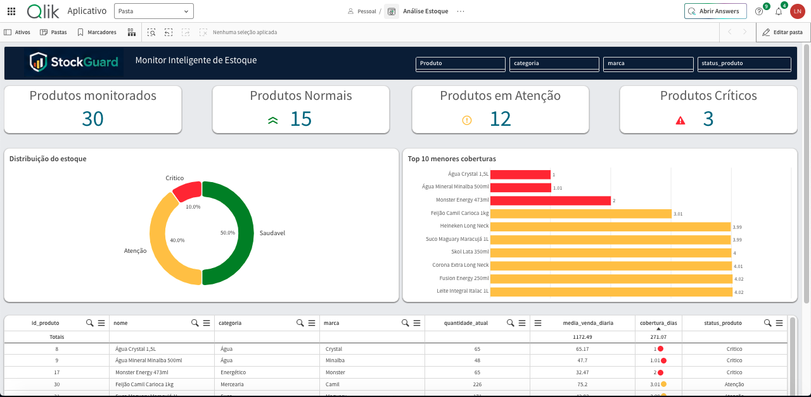
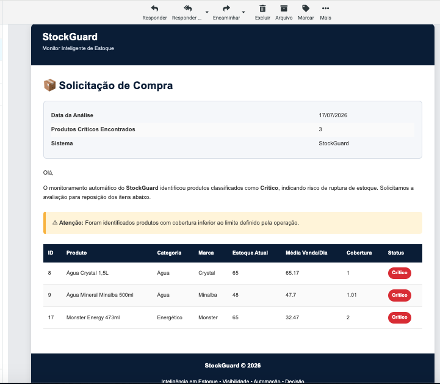
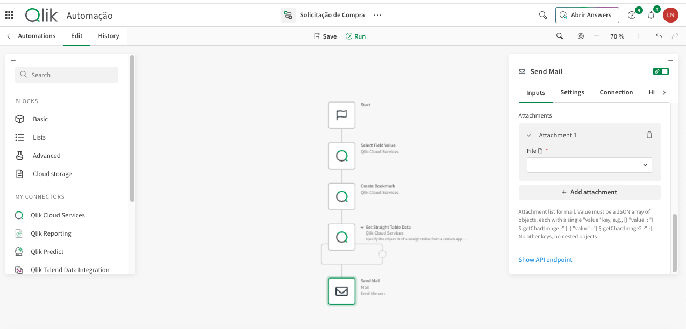

# Evidências em Capturas de Tela

Esta pasta contém as evidências públicas selecionadas para o estudo de caso StockGuard.

## 1. Dashboard de monitoramento de estoque

Apresenta o dashboard operacional Qlik com:

- produtos monitorados;
- quantidades nos status saudável / atenção / crítico;
- distribuição por status de estoque;
- ranking de menor cobertura;
- tabela operacional de produtos.

## 2. E-mail automatizado de solicitação de compra

Apresenta o e-mail HTML gerado para produtos classificados como críticos.

A mensagem consolida os itens críticos e apresenta as principais informações de reposição necessárias ao comprador.

## 3. Fluxo do Qlik Automation

Apresenta o fluxo de automação que recupera os dados relevantes do Qlik e executa a ação de envio do e-mail.

## Política de dados

Todos os dados exibidos neste projeto são fictícios e foram criados exclusivamente para demonstração e composição do portfólio.
